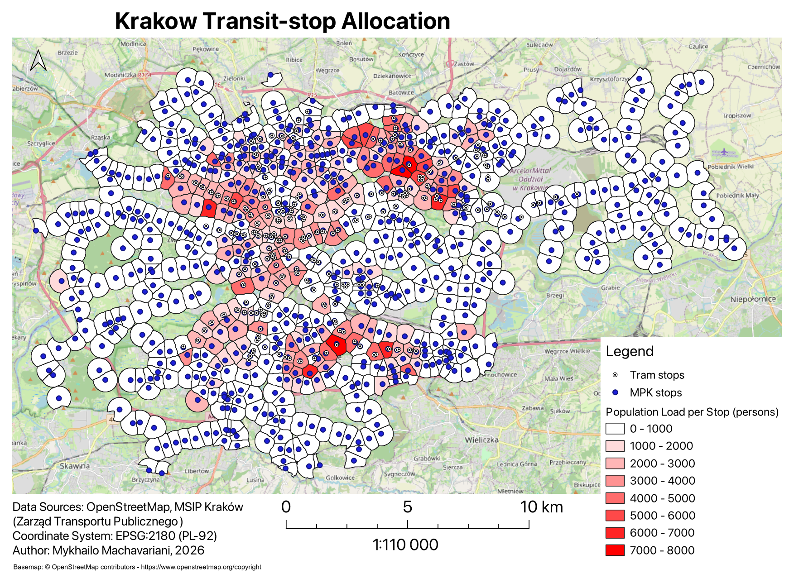

# Public transport accessibility in Krakow

## About the project

I used QGIS to study how close people in Krakow live to public transport stops. I worked with supplied stop locations and population estimates, mapped the 500 m coverage area, and calculated population totals for nearest-stop allocation zones. I then presented the results on a map.

## Main steps

1. Check the input layers in EPSG:2180, using 5 m raster cells.
2. Calculate distances to stops and create a 500 m coverage mask.
3. Compare the share of land and population inside that area.
4. Use GRASS `r.cost` with uniform movement cost to allocate areas to stops, then calculate population totals with zonal statistics.
5. Prepare the map.

## Open it

1. [Download the complete project ZIP](https://github.com/limerun/krakow-transit-accessibility/releases/download/v1.0/krakow-transit-accessibility-full-project.zip).
2. Extract the archive and open `project.qgz` in QGIS. Keep the `data` folder next to it.
3. Internet is needed for the OpenStreetMap background. Tested with QGIS 3.42.1.

The repository contains the map, project file and documentation. The ZIP in Releases also includes all required data files. See [data sources](DATA_SOURCES.md).
